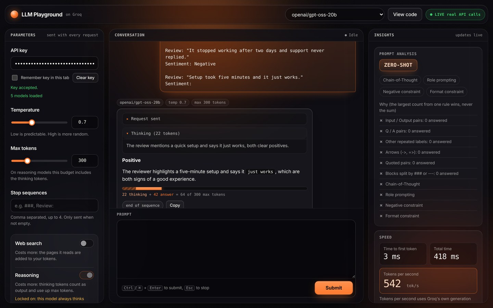

# LLM Playground

A single-file clone of the Groq console playground that makes **real, streaming LLM calls** from your browser. Built as teaching material for first-year engineering students, so the code favours readability over cleverness.

**Live demo:** https://llm-playground-prime-4bc4.vercel.app



## What it shows

| You change | You see |
|---|---|
| The prompt | Whether it is zero-shot, one-shot or few-shot, and which techniques it uses (chain-of-thought, role, constraints) |
| Temperature, max tokens, stop sequences | The exact JSON request that was sent, and why the reply stopped |
| A reasoning model | The model's thinking streamed live, and how much of the token budget it used |
| Web search (gpt-oss models) | The pages it read, as numbered source cards |
| Anything | Time to first token, tokens per second, and token usage straight from the API |

**View code** turns the current request into a ready-to-run `curl` command and a Python script.

## Quick start

1. Get a free API key from the [Groq console](https://console.groq.com/keys).
2. Open the [live demo](https://llm-playground-prime-4bc4.vercel.app) and paste the key.
3. Press **Submit**. The starter prompt is a two-example sentiment classifier.

To run it locally, download `index.html` and open it in a browser. There is nothing to install.

## How it works

The whole app is one `index.html`: CSS in a `<style>` tag, plain JavaScript in a `<script>` tag. Every section starts with a `WHAT THIS DOES` comment.

```
Your browser ──POST /chat/completions (stream: true)──▶ api.groq.com
             ◀──── data: {...}  data: {...}  data: [DONE] ────
```

1. `buildRequestBody()` builds the JSON, adding only the parameters the chosen model supports.
2. `fetch()` sends it with your key in the `Authorization` header.
3. `readStream()` reads the reply piece by piece and splits it into `data:` lines, holding back half-received lines until the rest arrives.
4. `handleChunk()` collects the answer text, thinking text, sources, finish reason and token usage.
5. `renderMarkdown()` escapes all HTML, then draws headings, lists, bold text and code blocks.

## Your API key

- It is typed in at runtime and sent only to `api.groq.com`.
- It is never written to a file. Tick **Remember key in this tab** to keep it in `sessionStorage` until the tab closes.
- The code export prints `$GROQ_API_KEY`, never the key itself.

## Project structure

```
index.html      the entire app
docs/           README screenshots
LICENSE         MIT
```

## Deploy your own

It is a static site, so any static host works. With [Vercel](https://vercel.com/new), import this repository and deploy. No build settings are needed.

## Limits

- Web search only works on the `openai/gpt-oss` models, through Groq's `browser_search` tool.
- On gpt-oss models, thinking is always on and is sent with `reasoning_effort: low` so it doesn't use up the whole budget.
- **Tokens left this minute** depends on Groq exposing the `x-ratelimit-remaining-tokens` header to browsers. If it doesn't, the panel says so.
- Groq's model line-up changes often. The model list loads live from the API; a small built-in list is used only if that fails.

## License

[MIT](LICENSE) © 2026 Srivathsa Sherla
